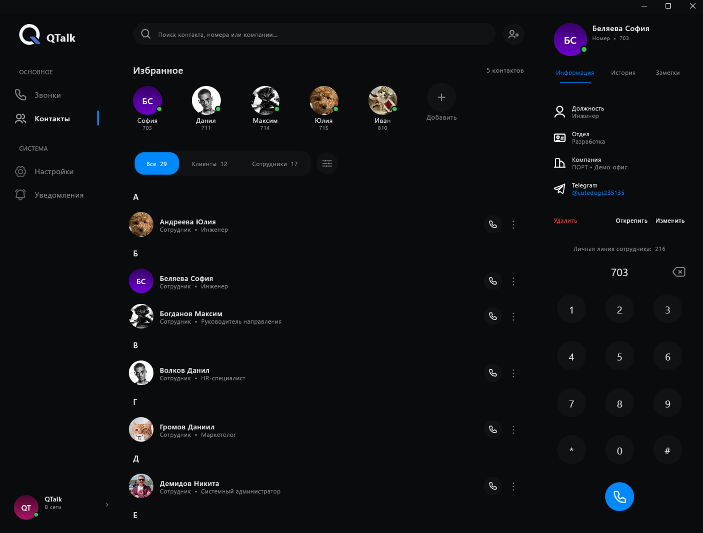
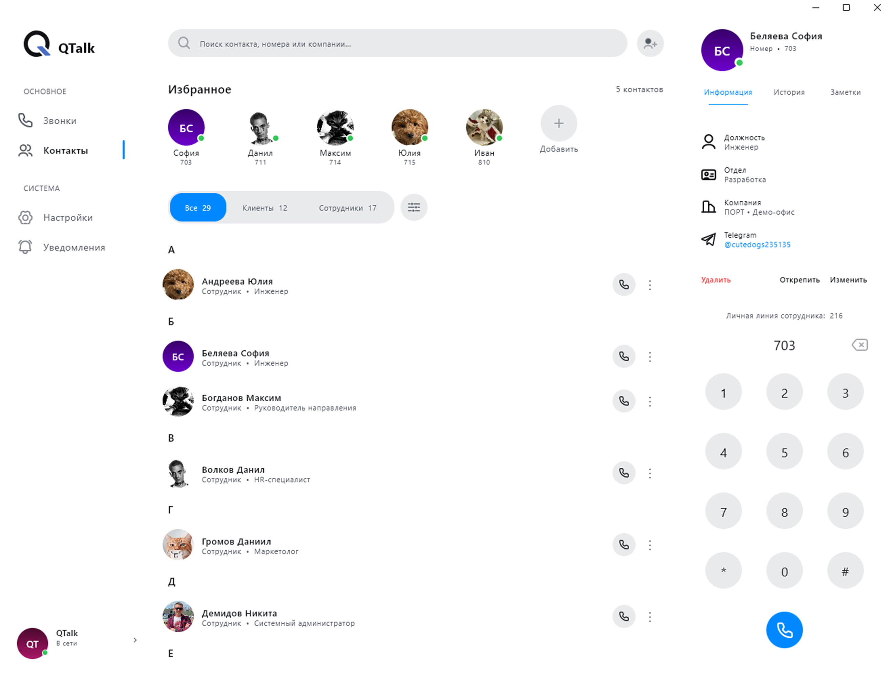

# QTalk

<p align="center">
  
</p>

<p align="center">
  Open-source SIP calling with a clean, focused desktop interface.
</p>

<p align="center">
  <strong>English</strong> · <a href="README_RU.md">Русский</a>
</p>

QTalk brings calls, contacts, favorites, and call history into one app. The desktop interface is built with Kotlin Multiplatform and Compose Multiplatform; liblinphone handles SIP and audio.

<p align="center">
  <a href="https://github.com/qvostedev/QTalk/releases/latest">Download the latest release</a> · <a href="#build-from-source">Build from source</a> · <a href="LICENSE.txt">License</a>
</p>

## Interface preview

These screenshots show the dark and light themes with sample data.

<table width="100%">
  <tr><th width="50%">Dark</th><th width="50%">Light</th></tr>
  <tr>
    <td width="50%"></td>
    <td width="50%"></td>
  </tr>
</table>

## Features

- Incoming and outgoing SIP audio calls, in-call controls, and transfer to an internal extension.
- Contacts, favorites, notes, and searchable call history.
- Optional contact synchronization from Google Sheets; locally added contacts are kept separately.
- Dark and light themes, plus a compact in-call widget.
- Audio device selection, microphone sensitivity, and ringtone volume settings.
- An in-app check for newer GitHub releases.

## Platform status

| Platform | Status |
| --- | --- |
| Windows (x64) | ✅ Ready; installer in [Releases](https://github.com/qvostedev/QTalk/releases/latest) |
| Linux (x86_64) | ✅ Ready; build from source |
| Android | In development |
| iOS | In development |

Desktop builds are usable and continue to evolve. Calls require your own SIP account and server; QTalk does not provide a telephony service. Contact synchronization is optional and configured locally.

## Install

On Windows, download the `QTalk-Setup-*.exe` installer from the [latest release](https://github.com/qvostedev/QTalk/releases/latest) and run it. Linux users can build the desktop app using the instructions below.

## Build from source

You need **JDK 21**. The repository includes the Gradle wrapper, so a separate Gradle installation is not required.

### Windows

```powershell
.\gradlew.bat :desktopApp:run
```

To build the Windows installer, install Inno Setup 6 and run:

```powershell
.\gradlew.bat :desktopApp:packageQTalkInstaller
```

The installer will be in `desktopApp/build/compose/binaries/main/exe/`. See the [installer notes](installer/windows/README.md) for details.

### Linux

On x86_64 Linux, use the provided Nix development shell or install JDK 21 and the required system libraries yourself:

```bash
nix develop
./gradlew :desktopApp:run
```

## How it is built

```text
Compose UI → ViewModel / use cases → VoipEngine → Linphone SDK
```

The shared Kotlin Multiplatform module contains the UI and application logic. The desktop-specific Linphone adapter implements `VoipEngine`, keeping SIP details separate from the rest of the app.

## License

QTalk is licensed under **AGPL-3.0-only**. See [LICENSE](LICENSE.txt). The software is provided without warranty.

Third-party components retain their own licenses. Linphone SDK 5.5.23 is dual-licensed; QTalk uses its open-source AGPLv3 option. See the [SDK README](https://github.com/BelledonneCommunications/linphone-sdk/blob/5.5.23/README.md) and [license](https://github.com/BelledonneCommunications/linphone-sdk/blob/5.5.23/LICENSE.txt).
